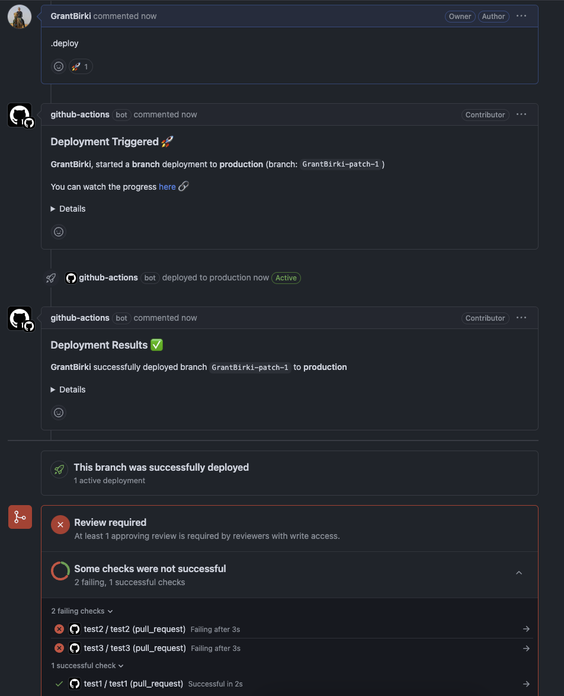
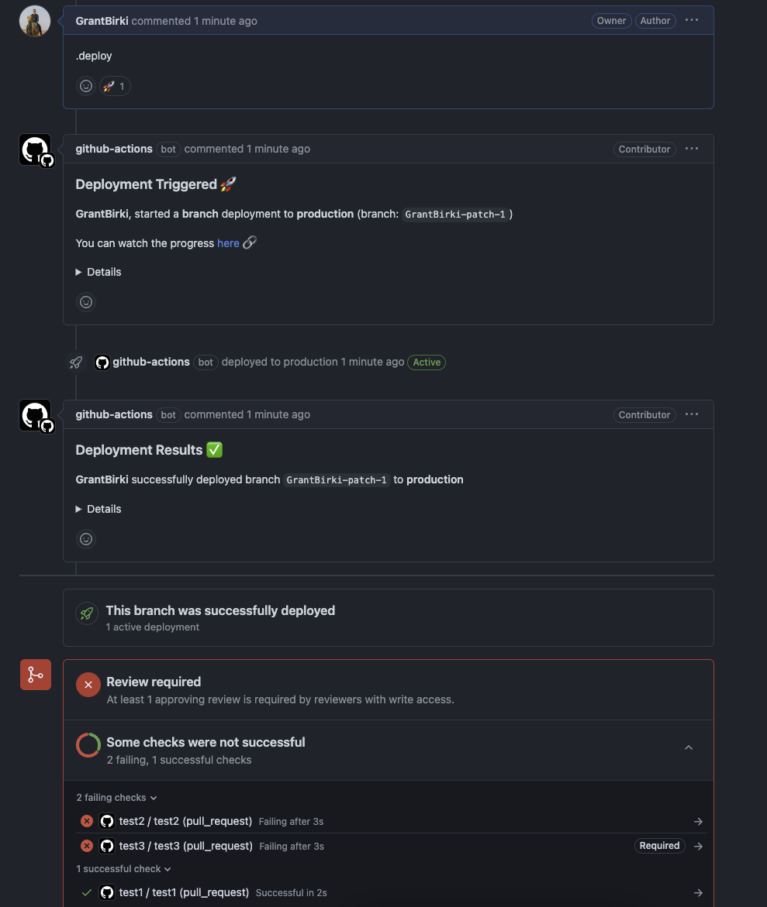

# Checks ✅

> This feature was originally requested via [#73](https://github.com/github/branch-deploy/issues/73) and further improved in [#321](https://github.com/github/branch-deploy/issues/321) and [#362](https://github.com/github/branch-deploy/issues/362)

The branch-deploy Action contains a useful input option to help give developers more control over how CI checks are handled during the deployment process. Some teams may have very strict controls over deployments and require **all status checks** to pass before a deployment can start. In this case, all CI checks must pass and that includes required, or non-required checks. Other teams may have a more relaxed approach and only require certain checks to pass before a deployment can start. This is where the `checks` input option comes in handy.

## Required CI Checks

First, let's explain what a "required" CI check is in case you're not familiar. A required CI check is a check that must pass before a pull request can be merged. This is a setting that can be configured in the repository settings under the "Branches" section. This section is shown in the screenshot below:

In this repository, the current ruleset requires the following CI checks:

- `test`
- `acceptance`
- `package-check`
- `lint`
- `actions-config-validation`

Any other CI checks that run on a pull request are not required and are considered non-required checks.

Branch Deploy evaluates the check runs and commit statuses on the selected commit. When GitHub returns them on one page (up to 100 results), the newest run for each GitHub App and check name, or the newest status for each legacy context, is authoritative. A selected result must be `SUCCESS`, `SKIPPED`, or `NEUTRAL`. Any other selected state or conclusion blocks deployment, including a newer pending or failing run when an older run passed. If your policy requires the work to run successfully, configure the check to fail instead of skipping it or reporting a neutral result.

With more than 100 results, GitHub can update checks between pages. Branch Deploy compares the results it read with GitHub's counts by state and starts over once if they disagree. It can proceed only when every reported result is successful, skipped, or neutral. A pending or failed result can therefore block deployment even if it appears optional, ignored, or superseded. If the Action cannot verify the results, it stops with `commit_status` set to `UNAVAILABLE`. Checks can still change after verification.

For PR deployments and noops, `checks: all` (the default) and `checks: required` also read the target branch's named status checks from classic protection and active rulesets. Required checks that have not reported yet block deployment. Repositories without required checks still work, and a rule that requires deployment before merge will not block the deployment itself.

If GitHub reports that rulesets are unavailable on the repository's plan, ordinary PRs still check classic protection. Other policy-read errors stop deployment. Required-workflow rules are not treated as named status checks for ordinary PRs. The `skip_ci` option and stable-branch or exact-SHA deployments retain their usual behavior.

When a required check names a specific GitHub App, Branch Deploy verifies that App. If the App is hidden in the PR's check data, the Action checks the exact run using the GitHub Checks API. If GitHub cannot verify the source, deployment stops. Legacy commit statuses still work for `any source` rules, but cannot satisfy an App-bound rule; report those checks with the Checks API instead.

## Using the `checks` Input Option

These examples assume GitHub returns the checks on one page. The verification rule for more than 100 results applies to every selection below.

### Example 1: All CI Checks Must Pass

This example shows how you can use the `checks` option to require all CI checks to pass before a deployment can start. This is the **default** behavior of the Action if you do not specify the `checks` option.

```yaml
- name: branch-deploy
  uses: grantbirki/branch-deploy@vX.X.X # replace with the latest version of this Action
  id: branch-deploy
  with:
    checks: "all" # all CI checks (required or not) must pass before a deployment can start to any environment
```

### Example 2: Only Required CI Checks Must Pass

This example shows how you can use the `checks` option to require only the **required** CI checks to pass before a deployment can start. This is useful if you have non-required checks that you don't want to block a deployment.

```yaml
- name: branch-deploy
  uses: grantbirki/branch-deploy@vX.X.X # replace with the latest version of this Action
  id: branch-deploy
  with:
    checks: "required" # only required CI checks must pass before a deployment can start to any environment
```

The screenshot below demonstrates how this option works in a real-world scenario. You can see how there are two CI checks defined on the pull request. One is called `test1` which is **required** and **passing**. The other is called `test2` which is **not required** and **failing**. Since the `checks` option is set to `required`, the deployment will start because the required check is passing and is the only status check taken into consideration for a deployment.


### Example 3: Only specific CI checks must pass (required or not)

If you only care about a specific CI check, you can use the `checks` option with a comma-separated list of checks that must pass. For example, if you only care about the `test1` check, you can do the following:

```yaml
- uses: grantbirki/branch-deploy@vX.X.X # replace with the latest version of this Action
  id: branch-deploy
  with:
    checks: 'test1' # we only care about the check named `test1`
```

This will require that the latest CI check named `test1` is healthy before a deployment (to any environment) can start. Its newest state or conclusion must be `SUCCESS`, `SKIPPED`, or `NEUTRAL`. This option will scan all CI checks (required or not), and only the checks specified in the `checks` option will be considered blocking for deployment. If you have 10 failing CI checks and one healthy selected check, the deployment will start.

Please note that just because you can _deploy_, doesn't always mean you can merge. You should always review the configuration options of this Action and the branch protection (or ruleset) polices within your repository and ensure that they are configured to meet your team's requirements.

> If you project has a lot of CI tests, no worries! You could do `test1,test2,<etc>` to specify multiple checks that must pass.



### Example 4: Only certain CI checks are ignored

```yaml
- uses: grantbirki/branch-deploy@vX.X.X # replace with the latest version of this Action
  id: branch-deploy
  with:
    ignored_checks: 'test2,test3' # these two checks are ignored and deployment will be allowed even if they are failing (and required)
```


